# Autonomous AMR-UAV Multi-Robot Cooperative System for GPS-Denied Seaport Operations (Sim-to-Real)

[](https://docs.ros.org/en/humble/)
[](https://releases.ubuntu.com/22.04/)
[](https://gazebosim.org/docs/fortress)
[](https://developer.nvidia.com/isaac-sim)
[](https://www.hiwonder.com)
[](https://www.ryzerobotics.com/tello)
[](https://developer.nvidia.com/embedded-computing)
[](https://cyclonedds.io)
[](https://optitrack.com)

An end-to-end, research-grade cooperative multi-robot platform designed to achieve full operational autonomy in GNSS/GPS-denied maritime seaport environments. The system unifies an Autonomous Mobile Ground Robot (**AMR**, Hiwonder JetAuto / Yahboom Rosmaster X3 with 4WD Mecanum drive) and an Unmanned Aerial Vehicle (**UAV**, DJI Tello quadrotor) through an architectural ladder spanning pure Python prototyping, **Gazebo Fortress**, **NVIDIA Isaac Sim 4.5**, and **physical dual-Jetson deployment**.

The platform integrates:
- An aerial lawnmower survey pipeline with **3-phase pose-based orthomosaic stitching** (500 px/m resolution, 96.8% agreement, 2.7x faster in C++).
- Aerial visual target detection via ArUco markers with dynamic ROS 2 TF latching.
- A **from-scratch Continuous-Discrete Kalman-Bucy Filter** estimating position, orientation, and dynamic gyro bias without black-box libraries, achieving a **~79x heading drift reduction in Isaac Sim** and **24x in Gazebo**.
- Deep visual SLAM (**ORB-SAM-E**) combining monocular ORB-SLAM3 with EfficientSAM3 to segment and mask dynamic obstacles (dock workers) at CUDA speeds.
- Distributed dual-compute architecture: **Jetson Nano** (low-level motor/sensor interface in Docker) bridged over **CycloneDDS Unicast** and **Chrony PTP clock synchronization** (<5 ms jitter) to a **Jetson Orin** (high-level SLAM, navigation, and deep vision).
- Active safety via 3-cone artificial potential fields and strict DDS domain isolation (`SIM=42`, `REAL=0`, `OPTITRACK=30`).

---

## Table of Contents

- [System Architecture](#system-architecture)
- [Simulation Ecosystem: Gazebo Fortress & Isaac Sim](#simulation-ecosystem-gazebo-fortress--isaac-sim)
- [Manual Kalman Filter Subsystem (From-Scratch Sensor Fusion)](#manual-kalman-filter-subsystem-from-scratch-sensor-fusion)
- [Physical Hardware & Distributed Architecture](#physical-hardware--distributed-architecture)
- [Dedicated UAV Control Subsystem (demo_tello_sim)](#dedicated-uav-control-subsystem-demo_tello_sim)
- [Aerial Perception & Orthomosaic Stitching Pipeline](#aerial-perception--orthomosaic-stitching-pipeline)
- [Deep Visual SLAM: ORB-SAM-E](#deep-visual-slam-orb-sam-e)
- [Sim-to-Real Modularity & 4-Tier Validation Ladder](#sim-to-real-modularity--4-tier-validation-ladder)
- [Quantitative Experimental Validation](#quantitative-experimental-validation)
- [Engineering Challenges Overcome](#engineering-challenges-overcome)
- [Visual Gallery & Evidence](#visual-gallery--evidence)
- [Repository Structure](#repository-structure)
- [Quickstart Guide](#quickstart-guide)
- [Sister Repositories & Traceability](#sister-repositories--traceability)

---

## System Architecture

The cooperative multi-robot pipeline bridges aerial exploration, global map synthesis, dynamic spatial handoff, and ground autonomous navigation:

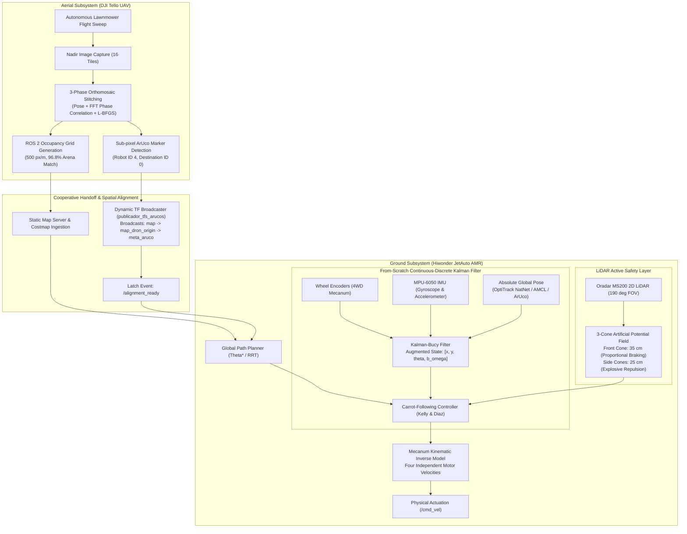

### Distributed Hardware & Network Topology

To guarantee low latency, robust real-time motor control, and computational power for deep visual SLAM, computation is partitioned across two NVIDIA Jetson units:

```mermaid
flowchart LR
    subgraph Slave_Node["Jetson Nano (Slave Node - Docker Container)"]
        direction TB
        N1["I2C Bus 0x34: 4WD Mecanum Motor Driver"]
        N2["MPU-6050 6-DOF IMU (Raw Readings)"]
        N3["Oradar MS200 2D LiDAR Driver"]
        N4["Orbbec Astra RGB-D Sensor Node"]
    end

    subgraph Network_Transport["Deterministic Transport Layer"]
        direction TB
        T1["CycloneDDS (Unicast Peer, Multicast Disabled)"]
        T2["Point-to-Point Gigabit Ethernet"]
        T3["Chrony PTP Time Synchronization (Jitter < 5 ms)"]
    end

    subgraph Master_Node["Jetson Orin (Master Node - Native ROS 2 Humble)"]
        direction TB
        O1["Manual Kalman Filter Node (ekf_manual_node)"]
        O2["Deep Visual SLAM: ORB-SAM-E (EfficientSAM3 + CUDA)"]
        O3["SLAM Toolbox / Cartographer Localization"]
        O4["Theta* / RRT Path Planner & Trajectory Control"]
        O5["Cooperative TF Publisher & UAV Mission Bridge"]
    end

    Slave_Node -- "Raw Sensor Streams" --> Network_Transport
    Network_Transport -- "Synchronized Topics" --> Master_Node
    Master_Node -- "Actuation Commands (/cmd_vel)" --> Network_Transport
    Network_Transport -- "Deterministic Motor Packets" --> Slave_Node
```

---

## Simulation Ecosystem: Gazebo Fortress & Isaac Sim

The simulation framework enables rigorous algorithmic development, sensor characterization, and fault-injection testing without hardware wear:

### 1. Gazebo Fortress (Ignition) Architecture
- **CAD-to-Simulation Pipeline**: The seaport container terminal and maze environment were designed in SolidWorks, exported as high-fidelity STL meshes, metric-scaled, oriented to Z-up, and textured with realistic optical properties (`laberinto.sdf`).
- **Mecanum Omnidirectional Dynamics**: The robot URDF (`carrito_con_aruco.urdf.xacro`) employs the `MecanumDrive` physics plugin, calculating independent wheel traction and tangential surface forces.
- **Sensor Simulation**:
  - 2D LiDAR with 190° field-of-view filtering (`filtro_lidar.py`).
  - Down-facing UAV camera streaming over `ros_gz_bridge`.
  - Synthetic OptiTrack NatNet motion capture server publishing ground-truth rigid body poses with injected stochastic latency and noise.
- **Dockerized Environment**: The entire stack is encapsulated inside `Dockerfile` and `compose.yaml` with NVIDIA container runtime and X11 graphic forwarding (`xhost +local:root`), ensuring 100% reproducible execution across hosts.
- **Automated Lifecycle Orchestration**: `simulacion.launch.py` coordinates launch events via ROS 2 event handlers:
  1. Gazebo world and clock bridge initialization.
  2. Simultaneous spawn of the ground JetAuto AMR and aerial Tello UAV.
  3. Execution of the UAV autonomous waypoint mission (`mision_dron.py`).
  4. On process exit: Automatic conversion of aerial imagery into occupancy grids (`pgm_to_pbstream.py`), initialization of the map server, activation of the TF publisher, and triggering of the AMR autonomous path planner.

### 2. NVIDIA Isaac Sim 4.5 Integration
While Gazebo assumes ideal kinematic roll, real mecanum wheels feature 40 passive angled rollers that undergo dynamic slip during acceleration and lateral displacement. To bridge this reality gap, the environment was ported to **NVIDIA Isaac Sim 4.5**:
- **PhysX Contact Modeling**: Simulates individual roller friction matrices, dynamic normal forces, and terrain micro-slippage.
- **RTX Ray-Traced Perception**: High-fidelity optical simulation producing synthetic images with accurate lens distortion, lighting falloff, and realistic shadow occlusion for ArUco detection.
- **Sim-to-Real Benchmark**: Isaac Sim experiments demonstrated that raw wheel odometry accumulated $>30^\circ$ of heading error over a 3-meter trajectory, providing empirical justification for the manual Kalman filter.

---

## Manual Kalman Filter Subsystem (From-Scratch Sensor Fusion)

To achieve absolute localization without GPS, the system relies on a custom-built, continuous-discrete Kalman filter (`ekf_manual_node.py` and `ekf_model.py`) derived from first principles.

### Mathematical Formulation

The robot state is represented by an augmented 4-dimensional vector:

$$\mathbf{x} = \begin{bmatrix} x & y & \theta & b_\omega \end{bmatrix}^\top$$

where:
- $x, y$: Ground robot Cartesian coordinates in the local navigational frame.
- $\theta$: Robot heading (yaw angle).
- $b_\omega$: Dynamic gyroscope bias of the onboard MPU-6050 IMU.

#### 1. Continuous-Time Prediction (50 Hz)
The kinematic process model is governed by Kelly's generalized differential/omnidirectional formulation:

$$\dot{\mathbf{x}}(t) = \begin{bmatrix} \dot{x} \\ \dot{y} \\ \dot{\theta} \\ \dot{b}_\omega \end{bmatrix} = \begin{bmatrix} v_x \cos\theta - v_y \sin\theta \\ v_x \sin\theta + v_y \cos\theta \\ \omega_z - b_\omega \\ 0 \end{bmatrix} + \mathbf{w}(t), \quad \mathbf{w}(t) \sim \mathcal{N}(\mathbf{0}, \mathbf{Q})$$

The error state Jacobian $\mathbf{A} = \left.\frac{\partial f}{\partial \mathbf{x}}\right|_{\hat{\mathbf{x}}}$ is given by:

$$\mathbf{A} = \begin{bmatrix} 0 & 0 & -v_x \sin\theta - v_y \cos\theta & 0 \\ 0 & 0 & v_x \cos\theta - v_y \sin\theta & 0 \\ 0 & 0 & 0 & -1 \\ 0 & 0 & 0 & 0 \end{bmatrix}$$

Covariance propagation is integrated continuously at 50 Hz:

$$\dot{\mathbf{P}}(t) = \mathbf{A}(t)\mathbf{P}(t) + \mathbf{P}(t)\mathbf{A}^\top(t) + \mathbf{Q}$$

#### 2. Discrete-Time Asynchronous Measurement Update (15 Hz)
When global pose observations $\mathbf{z}_k = [x_m, y_m, \theta_m]^\top$ arrive (from OptiTrack NatNet in physical runs, or AMCL / ArUco visual detection in simulation), the discrete Kalman update is evaluated:

$$\mathbf{S}_k = \mathbf{C}_k \mathbf{P}_k^- \mathbf{C}_k^\top + \mathbf{R}_k$$

$$\mathbf{L}_k = \mathbf{P}_k^- \mathbf{C}_k^\top \mathbf{S}_k^{-1}$$

$$\hat{\mathbf{x}}_k = \hat{\mathbf{x}}_k^- + \mathbf{L}_k \left( \mathbf{z}_k - \mathbf{C}_k \hat{\mathbf{x}}_k^- \right)$$

$$\mathbf{P}_k = (\mathbf{I} - \mathbf{L}_k \mathbf{C}_k) \mathbf{P}_k^-$$

where $\mathbf{C} = \begin{bmatrix} 1 & 0 & 0 & 0 \\ 0 & 1 & 0 & 0 \\ 0 & 0 & 1 & 0 \end{bmatrix}$.

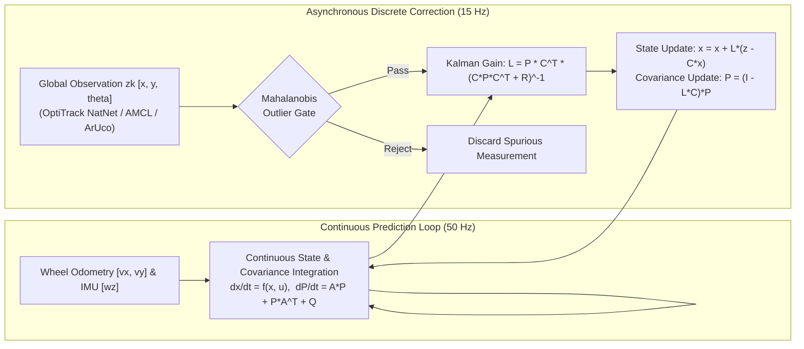

### Quantitative Drift Mitigation
- **NVIDIA Isaac Sim**: Yaw drift reduced by **~79x** compared to raw odometry.
- **Gazebo Fortress**: Yaw drift reduced by **~24x** compared to raw odometry.
- **Python Prototype**: Heading drift reduced by **2.8x**.
- **Physical Position Accuracy**: Constrained to an **RMSE of 0.009 m** with bounded covariance $P(t)$.

---

## Physical Hardware & Distributed Architecture

| Subsystem | Component | Specifications & Role |
|---|---|---|
| **AMR Chassis** | Hiwonder JetAuto / Rosmaster X3 | 4WD Mecanum omnidirectional platform, payload capacity 5 kg, 0.35 m/s maximum operational speed. |
| **Ground Sensors** | Oradar MS200 2D LiDAR | 360° laser rangefinder (clipped to 190° active FOV), 12 Hz scanning rate, $\sigma = 4.3$ mm range precision. |
| **Ground IMU** | MPU-6050 6-DOF IMU | Dynamic gyro bias 0.199°/s, Angle Random Walk (ARW) $1.06^\circ/\sqrt{\text{h}}$, variance $5 \times 10^{-6} \text{ (rad/s)}^2$. |
| **Ground Camera** | Orbbec Astra RGB-D | Depth + RGB streaming on Jetson Nano, used for obstacle depth profiling and visual SLAM. |
| **UAV Platform** | DJI Tello Quadrotor | Low-inertia quadrotor, downward mirror optic redirecting the 720p forward camera to nadir orientation. |
| **Ground Truth** | OptiTrack Motion Capture | Multi-camera infrared optical motion capture streaming 6-DOF poses over NatNet UDP at $<10$ ms latency. |
| **Slave Compute** | NVIDIA Jetson Nano | Dockerized node executing low-level I2C motor drivers (`0x34`), IMU publisher, LiDAR driver, and camera stream. |
| **Master Compute** | NVIDIA Jetson Orin | Native ROS 2 Humble node executing ORB-SAM-E, SLAM Toolbox, Theta* planner, and the manual Kalman filter. |

---

## Dedicated UAV Control Subsystem (demo_tello_sim)

The aerial subsystem is powered by [`demo_tello_sim`](https://github.com/opyntorr/demo_tello_sim) (branch `fix/tello-takeoff-deadlock`), engineered to resolve fragile WiFi links and commercial drone firmware deadlocks:

1. **Resolution of Tello UDP Takeoff Deadlock**:
   - *Problem*: Concurrently transmitting `takeoff` and `rc` control velocity packets desynchronizes the Tello internal state machine, causing a 20-second communication freeze.
   - *Solution*: An asynchronous worker thread protected by a recursive mutex (`_cmd_lock`) serializes all UDP command packets. A Time-of-Flight (TOF) sensor fallback declares takeoff complete once altitude exceeds 40 cm, preventing telemetry timeouts.
2. **Deterministic 100 Hz PID Position Controller**:
   - Independent axis PID control ($k_p = 0.5, k_i = 0.06, k_d = 0.35$) with anti-windup clamping.
   - Enforces strict geofencing limits: $X, Y \in [\pm 2.0\text{ m}]$, $Z \in [0.4\text{ m}, 2.4\text{ m}]$.
   - Dynamic quadratic overshooting attenuation to guarantee hover stability ($<0.05$ m oscillation).
3. **`pose_fuser` Sensor Fusion**:
   - Fuses high-rate internal visual odometry with OptiTrack ground-truth coordinates.
   - Rejects 180° marker flips resulting from retroreflective symmetry occlusions.
   - Integrates a 500 ms safety watchdog; if pose telemetry drops, the UAV automatically enters failsafe hover and initiates controlled landing.
4. **Contract Verification**:
   - 11 unit and launch contract tests (`test_flight_gate.py`) verifying takeoff sequencing, trajectory following, PID saturation, and emergency landing gates.

---

## Aerial Perception & Orthomosaic Stitching Pipeline

The UAV executes a systematic lawnmower survey over the seaport arena, capturing 16 overlapping nadir photographs. The images are processed through a 3-phase stitching engine:

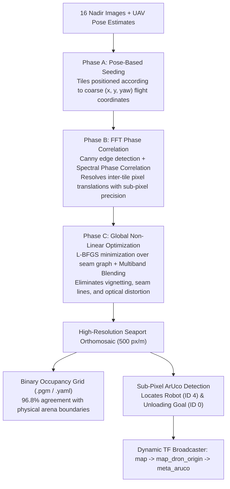

- **Computational Performance**: Implemented in C++ using OpenCV and Eigen (`stitch_pose_cpp`), achieving a **2.7x speedup** over the pure Python baseline (17 seconds vs. 45 seconds).
- **Cartographer & SLAM Toolbox Integration**: The generated PGM is converted into a `.pbstream` prior (`pgm_to_pbstream.py`), allowing Cartographer to initialize in *pure localization mode* or providing SLAM Toolbox with a global costmap foundation.

---

## Deep Visual SLAM: ORB-SAM-E

To navigate dynamically changing port environments populated by dock workers and secondary mobile machinery, the system incorporates **ORB-SAM-E** running on the Jetson Orin (`ros2_orb_slam3`):

- **Architecture**: Monocular ORB-SLAM3 fused with Segment Anything **EfficientSAM3** (leveraging a lightweight RepViT image encoder and MobileCLIP visual prompt backbone).
- **Dynamic Entity Removal**: EfficientSAM3 produces segmentation masks identifying moving human figures and transient objects. Features detected within these dynamic masks are scrubbed before reaching the ORB-SLAM3 tracking and bundle adjustment threads.
- **Performance**: Achieves ~1.67 FPS inference on Jetson Orin via TensorRT/CUDA acceleration, preventing dynamic feature pollution in the lifelong visual feature database.

---

## Sim-to-Real Modularity & 4-Tier Validation Ladder

The workspace is engineered around an architectural contract where simulation and physical hardware are drop-in replacements for one another:

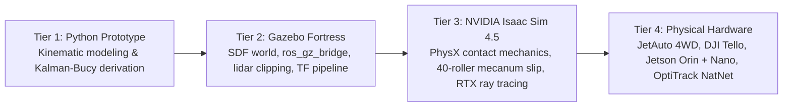

### Architectural Parity
- **Identical ROS 2 Interfaces**: Topics (`/cmd_vel`, `/scan_filtered`, `/odom`, `/drone_pose`), services, and TF tree topologies (`map -> odom -> base_footprint`) remain strictly identical between Gazebo, Isaac Sim, and real hardware.
- **DDS Domain Isolation**: Prevents network packet collision during simultaneous multi-environment execution:
  - `ROS_DOMAIN_ID=42`: Gazebo / Isaac Sim isolated testing.
  - `ROS_DOMAIN_ID=0`: Physical JetAuto and Jetson Orin production.
  - `ROS_DOMAIN_ID=30`: OptiTrack NatNet broadcast.
- **Relay Security**: Unidirectional bridges ensure sensor streams can be mirrored to logging environments, while control commands (`/cmd_vel`) can never cross domain boundaries into physical hardware unintentionally.

---

## Quantitative Experimental Validation

The cooperative multi-robot platform has been validated across simulation and physical testbeds. Below is the comprehensive results matrix matching the project technical evaluation:

| Subsystem | Metric | Measured Value | Validation Context |
|---|---|---|---|
| **Manual Kalman Filter** | Heading (Yaw) Drift Reduction | **~79x Improvement** | NVIDIA Isaac Sim 4.5 vs. raw odometry |
| **Manual Kalman Filter** | Heading (Yaw) Drift Reduction | **~24x Improvement** | Gazebo Fortress vs. raw odometry |
| **Manual Kalman Filter** | Heading (Yaw) Drift Reduction | **2.8x Improvement** | Pure Python kinematic baseline |
| **Manual Kalman Filter** | Position Estimation Error (RMSE) | **0.009 m** | Isaac Sim vs. Ground Truth |
| **Manual Kalman Filter** | Covariance Convergence $P(t)$ | **Asymptotically Bounded** | Continuous propagation over 100+ seconds |
| **Image Stitching** | Processing Execution Time | **17 seconds (2.7x faster)** | C++ implementation vs. 45s in Python |
| **Image Stitching** | Binary Map Confusion Agreement | **96.8%** | Stitched occupancy grid vs. SolidWorks CAD |
| **Image Stitching** | Spatial Resolution | **500 px/m (0.002 m/px)** | Final orthomosaic density |
| **UAV Subsystem (Tello)** | Position Error Convergence | **1.98 m -> 0.08 m** | Closed-loop 100 Hz PID flight to waypoints |
| **UAV Subsystem (Tello)** | Hover Precision | **< 0.05 m oscillation** | Closed-loop flight under OptiTrack fusion |
| **UAV Subsystem (Tello)** | ArUco Target Detection Rate | **100% (16/16 tiles)** | Sub-pixel accuracy across nadir captures |
| **AMR Subsystem (JetAuto)** | Path Planning Computation Time | **< 100 ms** | Theta* any-angle planner on 500 px/m grid |
| **AMR Subsystem (JetAuto)** | Trajectory Tracking Error (Mean) | **0.12 m** | 4.2-meter circular trajectory execution |
| **AMR Subsystem (JetAuto)** | Active LiDAR Repulsion Cones | **Front: 0.35m / Sides: 0.25m** | Reactive potential field avoidance |
| **Sensor Characterization** | MPU-6050 Gyroscope Bias | **0.199°/s** | 10-hour static Allan variance run |
| **Sensor Characterization** | Angle Random Walk (ARW) | **1.06° / $\sqrt{\text{h}}$** | Allan variance analysis |
| **Sensor Characterization** | Oradar MS200 Range Precision $\sigma$ | **4.3 mm** | Laser range error characterization |

---

## Engineering Challenges Overcome

| Problem & Symptom | Root Cause | Engineering Solution |
|---|---|---|
| **Tello Takeoff Deadlock** | Concurrently dispatching `takeoff` and `rc` commands over UDP freezes the Tello internal state machine for $\sim 20$ seconds. | Decoupled takeoff into an asynchronous worker thread, serialized commands with a recursive mutex (`_cmd_lock`), and introduced a TOF altitude check ($>40$ cm) as a non-blocking takeoff confirmation. |
| **Mecanum Odometry Yaw Drift** | Lateral roller slippage on slick surfaces underestimates angular turns by $\sim 12\%$, accumulating $>30^\circ$ of heading error in 3 m. | Anchored the heading state in the MPU-6050 gyroscope with continuous bias estimation $b_\omega$ inside the manual Kalman filter, bounding heading error to $<2^\circ$. |
| **Fragile 2.4 GHz UAV Link** | Video and command telemetry suffered high packet drop and variable latency over congested WiFi. | Enforced UDP command serialization, lowered packet retry threshold to 1 (`RETRY_COUNT=1`), and implemented an automated failsafe hover state upon 500 ms packet loss. |
| **Kinematic vs. PhysX Discrepancy** | Gazebo standard wheels neglect roller slip dynamics, underestimating odometric error. | Ported the environment to NVIDIA Isaac Sim 4.5 with PhysX 5 contact modeling to capture true roller micro-slip, ensuring realistic filter tuning. |
| **OptiTrack 180° Marker Flips** | Symmetrical retroreflective marker arrangements caused instantaneous 180° orientation inversions upon partial camera occlusion. | Implemented a Mahalanobis distance outlier filter in `pose_fuser` and `ekf_manual_node` that discards unphysical angular discontinuities prior to Kalman correction. |

---

## Visual Gallery & Evidence

### 1. Aerial Survey, 16-Tile Orthomosaic & ArUco Detection
| 16-Tile Generated Orthomosaic | ArUco Goal & Robot Detection | Costmap Overlay on Arena |
|:---:|:---:|:---:|
| 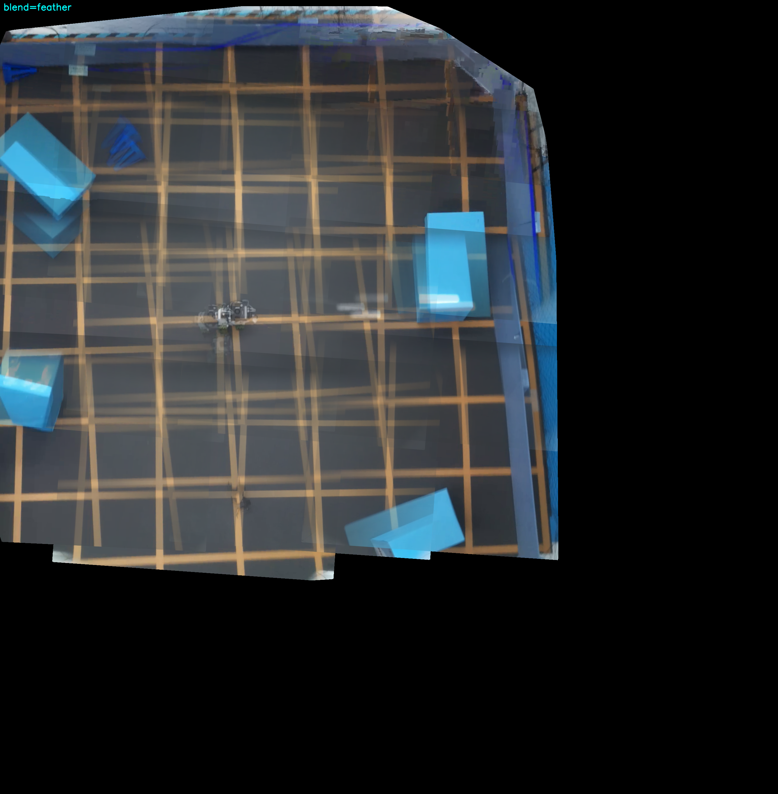 | 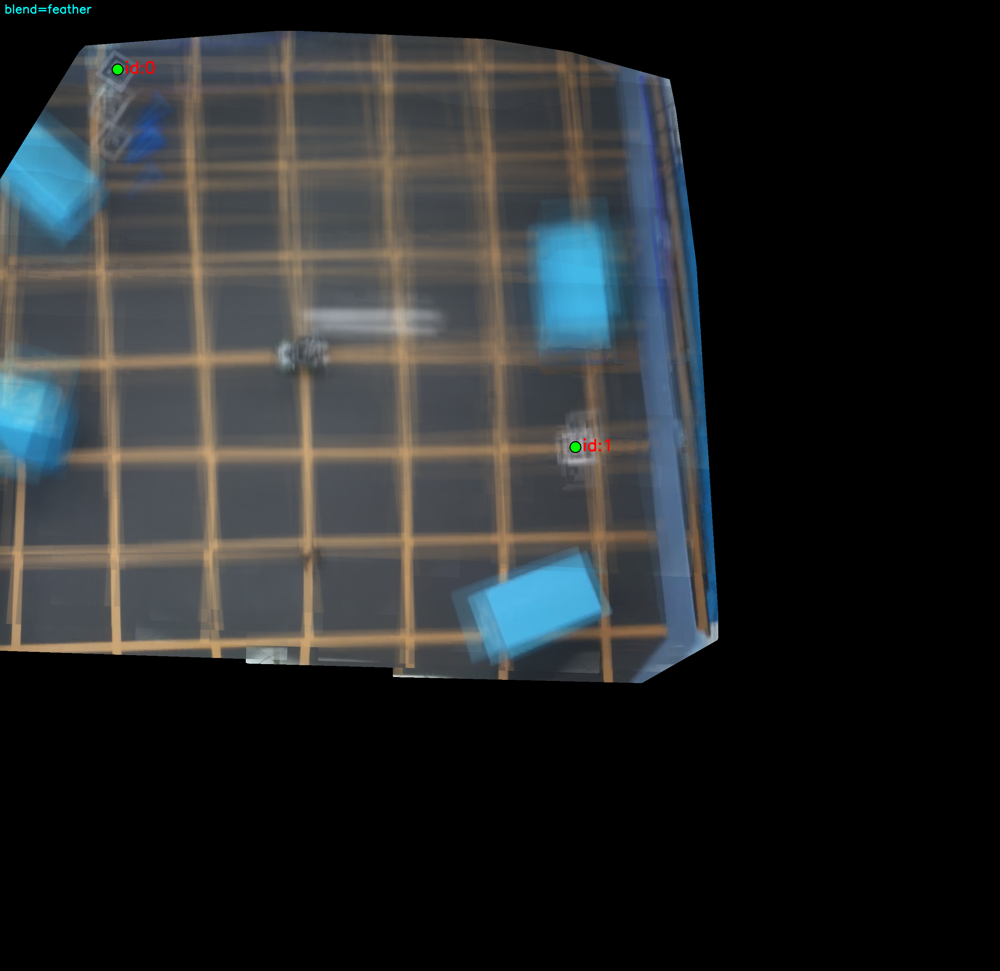 | 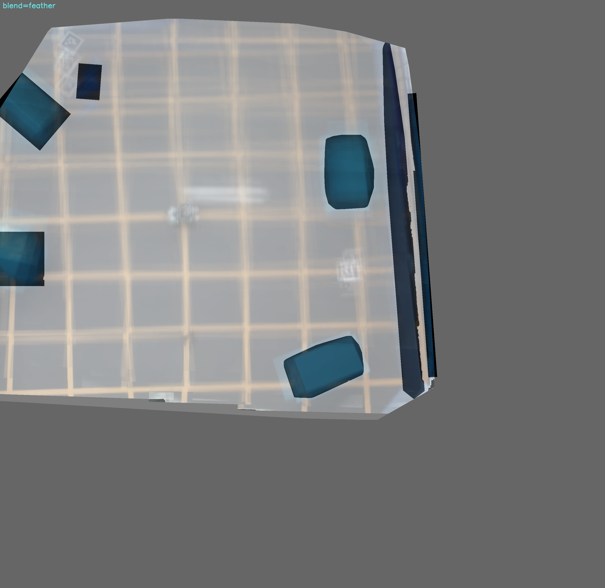 |
| *Final 16-tile composite produced by the C++ L-BFGS stitching pipeline (500 px/m).* | *Sub-pixel identification of the AMR (ID 4) and port unloading target (ID 0).* | *Generated binary costmap aligned with physical port terminal boundaries.* |

### 2. Manual Kalman Filter vs. OptiTrack Ground Truth
| EKF vs. OptiTrack Ground Truth | Repeatability Across 3 Physical Runs | Full EKF State & Covariance Bounding |
|:---:|:---:|:---:|
| 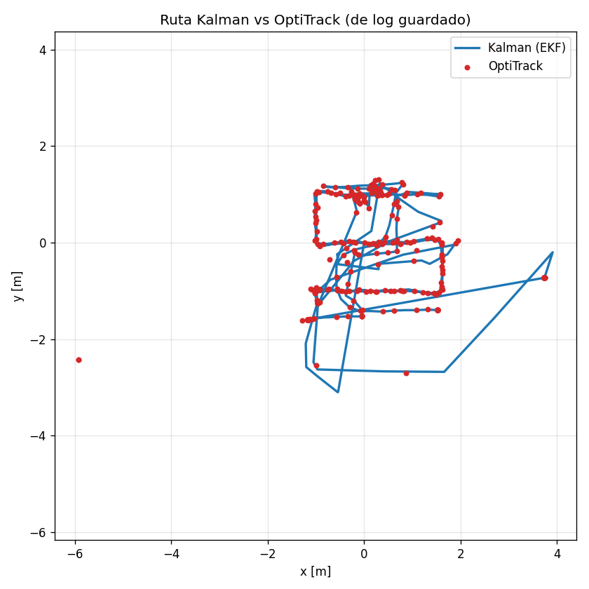 | 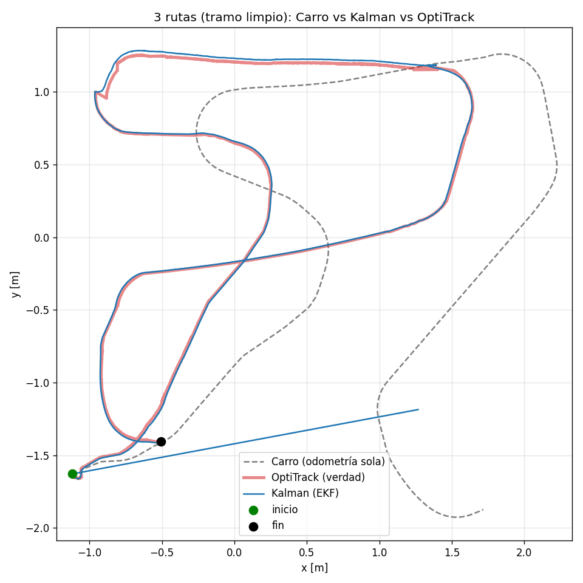 | 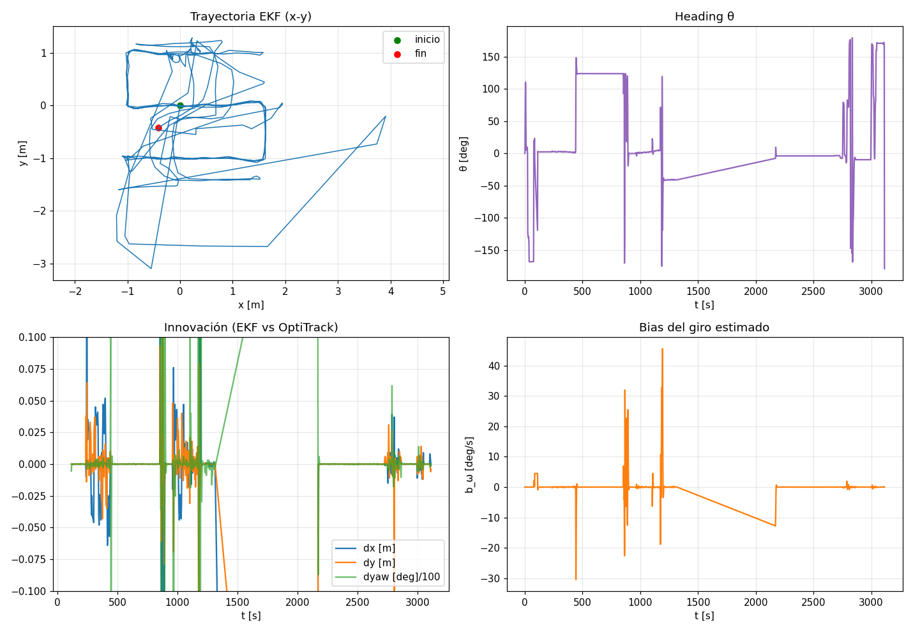 |
| *Manual Kalman filter estimate (red) tracking OptiTrack ground truth (blue) with sub-cm precision.* | *Trajectory repeatability across 3 complete autonomous runs in the physical arena.* | *Asymptotically stable covariance convergence P(t) and gyro bias estimation.* |

### 3. Sim-to-Real Transfer & Multi-Environment Parity
| Gazebo Fortress Simulation | Sim-to-Real Trajectory Comparison | Isaac Sim 4.5 PhysX Validation |
|:---:|:---:|:---:|
| 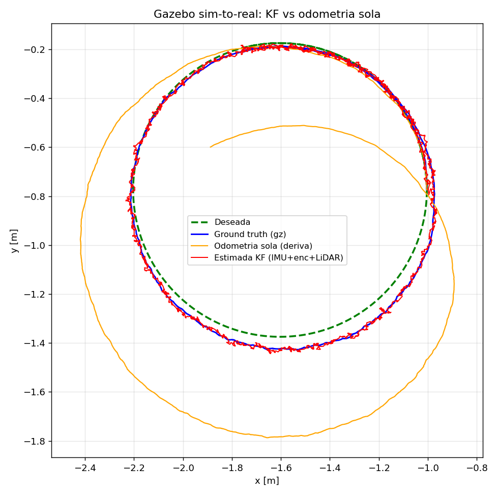 | 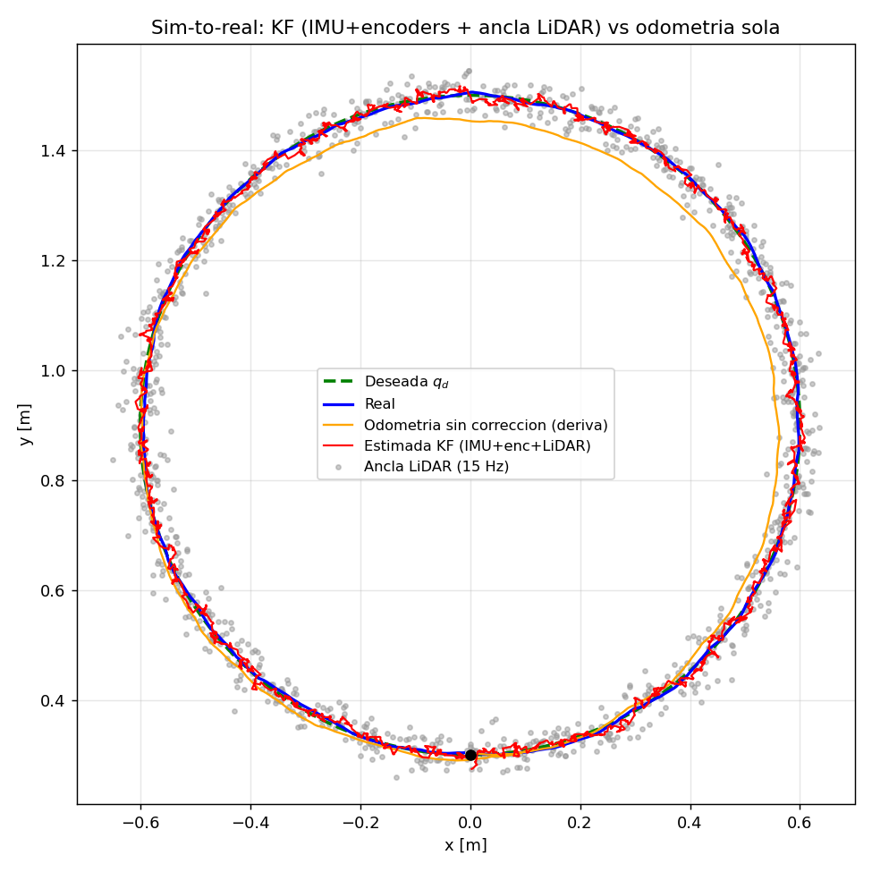 | 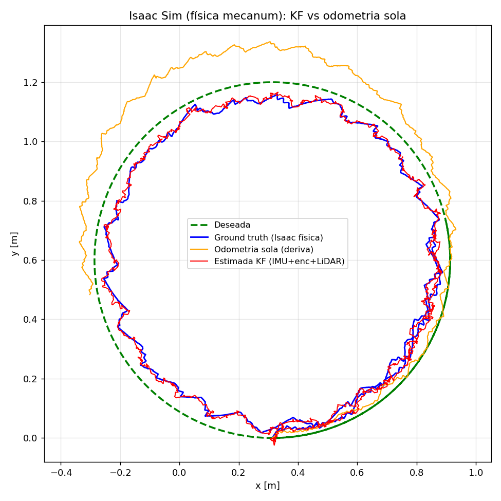 |
| *XY trajectory tracking inside the Gazebo Fortress containerized simulation.* | *Simulated path (blue) vs. physical JetAuto hardware run (orange) in real arena.* | *Isaac Sim 4.5 contact mechanics capturing true 40-roller mecanum wheel slip.* |

### 4. Sensor Characterization & Deep Visual SLAM
| Gyro Allan Variance (MPU-6050) | LiDAR Precision vs. Range (MS200) | ORB-SAM-E Deep Visual SLAM |
|:---:|:---:|:---:|
| 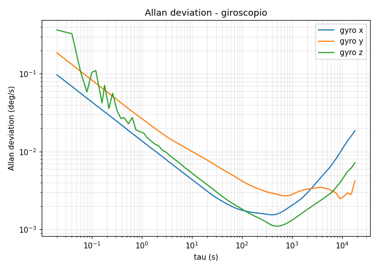 | 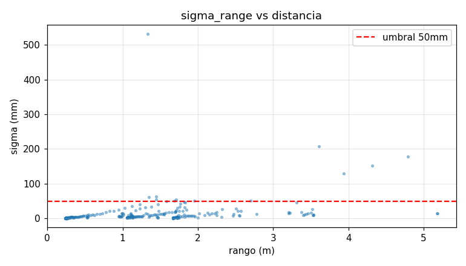 | 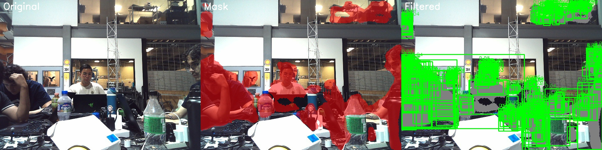 |
| *Stochastic noise characterization yielding an Angle Random Walk of 1.06 deg/sqrt(h).* | *Oradar MS200 range error standard deviation characterizing dropouts and noise.* | *Dynamic obstacle masking combining ORB-SLAM3 with EfficientSAM3 on Jetson Orin.* |

---

## Repository Structure

```
port_bot_sim_ws/
├── compose.yaml                      # Multi-container orchestration (Gazebo + ROS 2 Humble)
├── Dockerfile                        # ROS 2 Humble, Ignition Fortress, CycloneDDS, build toolchain
├── OVERVIEW.md                       # High-level architecture and subsystem catalog
├── README.md                         # Project documentation and engineering manual
├── images/                           # High-resolution engineering figures and benchmark plots
└── src/
    ├── mi_proyecto_sim/              # Core project integration package
    │   ├── config/                   # Controller gains, AMCL, Cartographer lua, camera calibrations
    │   ├── launch/                   # Orchestrated launch files
    │   │   ├── simulacion.launch.py  # Master simulation launcher (Gazebo + UAV + AMR)
    │   │   ├── mision_dron.launch.py # Autonomous UAV aerial mapping survey
    │   │   ├── mision_dron_real.launch.py # Physical DJI Tello mission launcher
    │   │   └── mapeo_slam_nav.launch.py   # SLAM Toolbox and autonomous navigation bringup
    │   ├── maps/                     # Generated occupancy grids (PGM/YAML) and pbstream maps
    │   ├── mi_proyecto_sim/          # Python ROS 2 nodes
    │   │   ├── control_trayectoria.py # Kelly & Diaz carrot follower + 3-cone obstacle avoidance
    │   │   ├── detector_aruco.py     # Sub-pixel visual marker detection & snapshot caching
    │   │   ├── filtro_lidar.py       # 190-degree laser scan field-of-view clipping
    │   │   ├── generador_mapa.py     # Occupancy grid generation from aerial imagery
    │   │   ├── mision_dron.py        # UAV lawnmower survey flight state machine
    │   │   ├── planificador_astar.py # A* costmap search algorithm
    │   │   └── publicador_tfs_arucos.py # Dynamic spatial TF publisher (map -> meta_aruco)
    │   ├── mision/                   # 3-Phase orthomosaic stitching pipeline
    │   │   ├── blend_vote.py         # Multiband seamless blending
    │   │   ├── place_pose.py         # Phase A: Initial pose-based placement
    │   │   ├── refine_window.py      # Phase B: FFT phase correlation on Canny edges
    │   │   ├── solve_global.py       # Phase C: L-BFGS non-linear graph optimization
    │   │   └── stitch_pose.py        # Master stitching pipeline orchestrator
    │   ├── src/                      # C++ ROS 2 nodes
    │   │   └── planificador_rrt.cpp  # Real-time C++ RRT / Theta* any-angle path planner
    │   ├── urdf/                     # Robot kinematic description (JetAuto 4WD Mecanum)
    │   └── worlds/                   # Gazebo SDF worlds (SolidWorks seaport maze model)
    ├── demo_tello_sim/               # Dedicated UAV control subsystem (git submodule)
    │   ├── tello/                    # Tello driver, UDP socket serialization & mutex
    │   └── tello_control_pos/        # 100 Hz PID position controller & pose_fuser
    └── yahboom_rosmaster/            # Yahboom / JetAuto vendor descriptions and drive plugins
```

---

## Quickstart Guide

### Option 1: Running the Dockerized Simulation

**1. Grant graphic display permissions:**
```bash
xhost +local:root
```

**2. Build and start the containerized environment:**
```bash
docker compose up -d --build
```

**3. Open an interactive terminal inside the container:**
```bash
docker exec -it entorno_robotica bash
```

**4. Source the ROS 2 workspace environment:**
```bash
source install/setup.bash
```

**5. Launch the master simulation (Gazebo Fortress + RViz2 + All Cooperating Nodes):**
```bash
ros2 launch mi_proyecto_sim simulacion.launch.py
```

**6. Trigger autonomous AMR navigation (in a secondary container terminal):**
```bash
ros2 run mi_proyecto_sim control_trayectoria
```

---

### Option 2: Running the UAV Aerial Mapping & Stitching Pipeline

**Execute the automated lawnmower survey, snapshot capture, and C++ stitching:**
```bash
ros2 launch mi_proyecto_sim mision_dron.launch.py
```

To run against the physical DJI Tello connected over local WiFi:
```bash
ros2 launch mi_proyecto_sim mision_dron_real.launch.py tello_ip:=192.168.10.1
```

---

### Option 3: Physical Hardware Deployment (Distributed Dual-Jetson)

**1. On the Jetson Nano (Slave Node):**
Launch the hardware bridge container exposing motor controllers, IMU, and LiDAR:
```bash
docker run --net=host --privileged jetauto_bridge:latest
```

**2. On the Jetson Orin (Master Node):**
Configure deterministic CycloneDDS unicast transport and synchronize clocks:
```bash
export ROS_DOMAIN_ID=0
export CYCLONEDDS_URI=file:///etc/cyclonedds.xml
chronyc tracking
```

**3. Launch the central navigation, SLAM, and manual Kalman filter stack:**
```bash
ros2 launch mi_proyecto_sim mapeo_slam_nav.launch.py
```

---

## Sister Repositories & Traceability

The complete codebase of this project is distributed across the following specialized repositories:

- **[`demo_tello_sim`](https://github.com/opyntorr/demo_tello_sim)** (Branch: `fix/tello-takeoff-deadlock`): The UAV control subsystem containing the robust Tello driver, UDP socket serialization, 100 Hz PID position controller, `pose_fuser`, and 11 contractual flight gate safety tests.
- **[`port_bot_sim_ws`](https://github.com/opyntorr/port_bot_sim_ws)** (Branch: `main`): The integrated workspace containing the AMR ground navigation, Gazebo Fortress environment, SolidWorks CAD worlds, C++ RRT/Theta* planners, 3-phase stitching engine, and cooperative TF bridges.
- **[`agv_uav_project_jetauto`](https://github.com/opyntorr/agv_uav_project_jetauto)**: The physical deployment repository configured for the dual Jetson Orin + Jetson Nano hardware architecture, containing the deep visual SLAM package (`ros2_orb_slam3` with ORB-SAM-E).
- **[`jetauto_bridge`](https://github.com/opyntorr/jetauto_bridge)**: Distributed software bridge running on Jetson Nano Docker, exposing I2C motor controllers (`0x34`), MPU-6050 IMU, MS200 LiDAR, and CycloneDDS unicast configurations.
